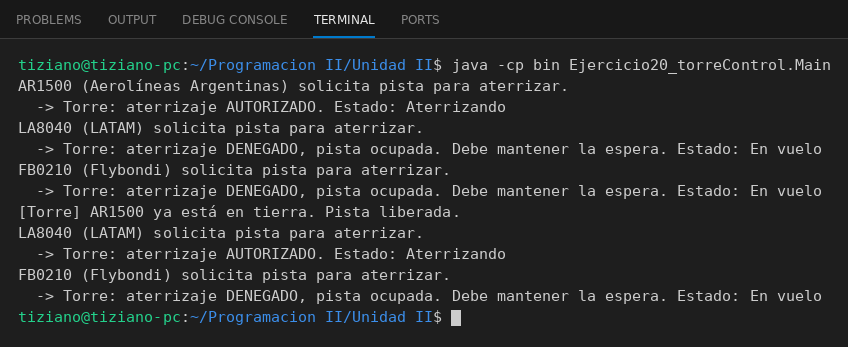

# TorreControl

Programación II - Unidad 2 - Ejercicio 20

## Consigna
Aviones solicitan a una torre de control autorización para aterrizar; la torre responde según el estado de la pista.

## Lógica
- `Avion`: código, aerolínea y estado (En vuelo, Aterrizando, En tierra); `cambiarEstado`.
- `TorreControl.autorizarAterrizaje(avion)`: si la pista está ocupada retorna `false`; si no, la ocupa e invoca `avion.cambiarEstado("Aterrizando")`.
- `liberarPista` pasa el avión a "En tierra" y libera la pista.
- `Main`: tres aviones piden pista consecutivamente; solo uno es autorizado hasta que la pista se libera.

## Ejecución

